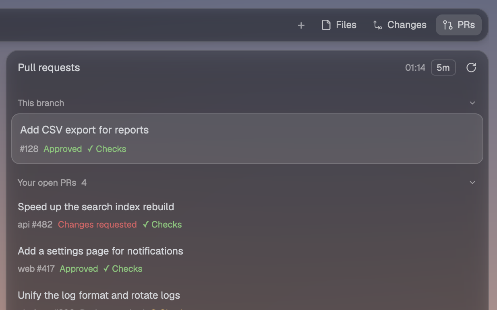

# PR List for Herdr

Your GitHub pull requests in a side panel of the [Herdr](https://herdr.dev) desktop app:
the pull request for the branch you're on, your open pull requests, and the ones waiting
on your review, each with its review and check state.



The picture shows it in the [Herdr Glass](https://github.com/noah4520/herdr-glass)
layout. It takes its colours from the theme, so it matches whatever layout it sits in.

Version 0.1.0, built on herdr-app 0.1.16. What changed in each version is in
[CHANGELOG.md](CHANGELOG.md).

## Features

- **This branch.** The pull request of the focused terminal's branch, as a card at the
  top: its title, number, review, checks, and whether it has a conflict.
- **Your open PRs** and **Waiting on your review**, the 20 newest of each, with the
  repository, review state and checks.
- **Its own PRs button** beside the tab bar's Files and Changes buttons. It comes with
  the mod, so it works with Herdr's own tab bar and with any layout's.
- **A click opens the pull request** in your browser.
- **Refreshes by itself** while the panel is open: every 2, 5, 10, 15 or 30 minutes, or
  off. Click the interval in the header to change it.
- **Read only.** It reads through your `gh` login and never changes anything on GitHub.

## Install

Ask your agent, from a terminal in Herdr:

```
Read ~/.config/herdr-app/AGENTS.md, then add this mod: herdr.dev/mods/noah4520/herdr-pr-list
```

It reads every file, copies the mod and puts its two blocks in your layout. Or do it
yourself:

```sh
git clone https://github.com/noah4520/herdr-pr-list.git
cd herdr-pr-list
./scripts/install.sh
```

Then add the mod to a layout of your own. Herdr's shipped layouts are read-only, so clone
one first if you use them: `herdr-app do layout.clone '{"name":"main","as":"my-main"}'`
(it also switches to the clone). In `~/.config/herdr-app/layouts/<your layout>.json`:

1. Add the panel to the `panel-body` stack, next to Files and Changes:

   ```json
   { "id": "pr-list", "type": "block", "content": { "mod": "pr-list" } }
   ```

2. Put the tab bar's block in a row and add the button after it. In a clone of Herdr's
   `main`, replace the `tabs` block with:

   ```json
   { "id": "tab-bar", "type": "row", "size": { "px": 42 }, "resizable": false, "children": [
     { "id": "tabs", "type": "block", "window_drag": true, "content": { "mod": "tabs" } },
     { "id": "pr-list-button", "type": "block", "size": { "px": 67 }, "window_drag": true,
       "content": { "mod": "pr-list", "props": { "button": true } } } ] }
   ```

Herdr reloads the layout when you save it.

**What it needs**

- The Herdr app. PR List is built and tested on herdr-app 0.1.16, on macOS. Linux should
  work but is untested; Windows isn't supported (opening a pull request runs `sh`).
- The [GitHub CLI](https://cli.github.com), logged in with `gh auth login`.

### In Herdr Glass

[Herdr Glass](https://github.com/noah4520/herdr-glass) already has the row. Add the panel
block as above, and put the button after `tab-strip` in its `tabs` row, with Glass's
rounder pill and no divider line:

```json
{ "id": "pr-list-button", "type": "block", "size": { "px": 65 }, "window_drag": true,
  "content": { "mod": "pr-list", "props": { "button": true, "radius": 8, "divider": false } } }
```

### Button options

| In `props` | What it does |
|---|---|
| `"button": true` | Draws the button instead of the panel |
| `"radius": 8` | The pill's corner; 6 by default, as Herdr's own panel buttons |
| `"divider": false` | No line under the button; by default it continues the line under Herdr's tab bar |

The button block's `size.px` is the pill's width, 57, plus the space after it: 10 at the
edge of Herdr's tab bar, 8 at the edge of Herdr Glass's.

## Update and remove

To update, pull and install over the old files: `git pull && ./scripts/install.sh --force`.

To remove it, take the two blocks out of your layout and delete the mod:

```sh
rm -r ~/.config/herdr-app/mods/pr-list ~/.config/herdr-app/data/pr-list
```

## What it runs and stores

- `gh api graphql` for the two lists, and `gh pr view` and `git branch --show-current` in
  the focused terminal's folder for "This branch". Only `gh` talks to GitHub, with your
  own login, and only to read.
- `open` (or `xdg-open`) with the pull request's address when you click one.
- The folded sections and the refresh interval are kept in the mod's own storage
  (`~/.config/herdr-app/data/pr-list/`). The button adds the panel to Herdr's shared
  `workspace.panels` list, so the tab bar remembers it per space.

## What's inside

| Path | What it is |
|---|---|
| `mods/pr-list` | The mod: the panel and its button |
| `scripts/install.sh` | Copies the mod into `~/.config/herdr-app/mods` and checks it |
| `RECIPE.md` | The brief an agent can install or rebuild PR List from |

## License

[MIT](LICENSE). The icons are from [Lucide](https://lucide.dev), ISC
([licenses/Lucide-ISC.txt](licenses/Lucide-ISC.txt)). PR List is a community mod, not
affiliated with or endorsed by Herdr or GitHub.
