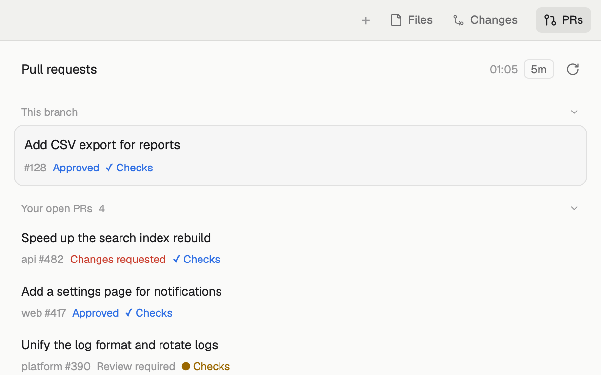

# PR List

Your GitHub pull requests in a side panel of the Herdr window: the pull request for the
branch of the terminal you're in, your open pull requests, and the ones waiting on your
review, each with its review and check state. A PRs button beside the tab bar opens and
closes it, and a click on a pull request opens it in the browser. It reads through your
own `gh` login and changes nothing on GitHub. PR List 0.1.0, built on herdr-app 0.1.16.



## What you see

Colours are theme names, so it follows whatever theme and layout it sits in.

- **The PRs button**, after the tab bar's own Files and Changes buttons: a 26px pill
  (8px side padding, 5px gap) with a 14px pull-request icon and "PRs" in 12px. `selected`
  with `foreground` text while its panel shows, `chrome` with `muted` text otherwise,
  `hover` on hover, like the tab bar's own panel buttons.
- **The panel**, in the side panel next to Files and Changes:
  - **Header**, 42px, 14px left and 8px right padding: "Pull requests" (13px semibold);
    the time of the last refresh as `HH:MM` (11px `dim`, "Updating…" while loading); a
    bordered chip (20px high, 5px radius, 11px `muted`) with the refresh interval, `5m`
    by default; a 26px refresh button with a 14px round-arrow icon that turns once every
    900ms while loading.
  - **Section headers**, 11px `dim`: a semibold title, a count, and at the right an 11px
    chevron, pointing down while the section is open and right while folded.
  - **This branch**: the pull request of the focused terminal's branch as a card (10px
    radius, `raised`, 1px `border`): its title in 13px semibold, then a line with `#n`
    and its states. Without one it reads "No PR for <branch>".
  - **Your open PRs**, then **Waiting on your review**: rows of two lines (8px radius,
    `hover` on hover): the title in 12.5px, truncated, then `repo #n` and its states in
    11px `dim`. Empty, they read "No open PRs." and "Nothing to review."
  - **States**, on the second line: a Draft, Merged or Closed badge (18px high, the
    colour at 15% behind its text); the review, "Approved" in `done`, "Changes
    requested" in `blocked`, "Review required" in `dim`; the checks, "✓ Checks" in
    `done`, "✗ Checks" in `blocked`, "● Checks" in `working`; and "Conflict" in `blocked`.
  - An error (no `gh`, not logged in) shows as one line in `blocked` at the top.

## How it behaves

- **The button** shows the panel on this mod's block, or hides the panel when it is
  already showing it. The first click adds the block's id to the shared
  `workspace.panels` list, which the tab bar needs to remember each space's panel.
- **Refresh**: when the panel first shows, when the focused folder changes, on the
  refresh button, and on the chosen interval while the panel shows; never while hidden.
  A click on the interval chip cycles 2m, 5m, 10m, 15m, 30m, Off.
- **This branch** follows the focused pane's folder (else the space's), as Herdr's Files
  panel does. It is left out when that folder isn't a git checkout; on a detached HEAD
  it says so; in a space on another machine it reads "Remote space: run gh there."
- **A click** on the card or a row opens that pull request in the browser.
- **A click on a section header** folds the section. Folded sections and the interval
  are remembered in the mod's own storage.
- Placed as a plain block outside the side panel stack, it counts as always shown.

## Built from

- **Mod** `mods/pr-list/`: `main.js`, `mod.json` (`{ "place": "none" }`: a layout places
  it), `pr.svg` and `refresh.svg` (Lucide, drawn with `svg()` so they take the text
  colour). The section chevrons are Herdr's own `mods/workspace-chrome/chevron-*.svg`.
- **One mod, two blocks.** With `props: { button: true }` it draws the button; without,
  the panel. The button finds the panel block by looking in the layout's `panel-body`
  stack for a block whose mod is `pr-list`, so the panel block's id is free.
  - `props.radius`: the pill's corner, 6 by default as Herdr's own panel buttons.
  - `props.divider: false`: no line under the button, for a tab bar without one. By
    default it draws a 1px `border` line along its bottom, continuing the one Herdr's
    tab bar draws.
- **Placement** (not shipped: the person's own layout). In a clone of Herdr's `main`,
  the panel is one more child of the `panel-body` stack, and the `tabs` block goes into
  a 42px row with the button after it:

  ```json
  { "id": "pr-list", "type": "block", "content": { "mod": "pr-list" } }
  ```

  ```json
  { "id": "tab-bar", "type": "row", "size": { "px": 42 }, "resizable": false, "children": [
    { "id": "tabs", "type": "block", "window_drag": true, "content": { "mod": "tabs" } },
    { "id": "pr-list-button", "type": "block", "size": { "px": 67 }, "window_drag": true,
      "content": { "mod": "pr-list", "props": { "button": true } } } ] }
  ```

  The button block is the pill's width, 57px, plus the 10px Herdr's tab bar keeps at its
  edge.
- **Data**, through `exec`:
  - `gh api graphql -f query=…` with two aliased searches, 20 newest each:
    `is:pr is:open review-requested:@me archived:false sort:updated-desc` and
    `is:pr is:open author:@me archived:false sort:updated-desc`, reading number, title,
    url, isDraft, reviewDecision, headRefName, repository.name and the last commit's
    `statusCheckRollup.state`.
  - `git branch --show-current`, then `gh pr view --json
    number,title,url,state,isDraft,reviewDecision,statusCheckRollup,mergeable,headRefName`
    in the focused folder.
  - `sh -c 'open "$1" 2>/dev/null || xdg-open "$1"'` to open a pull request.
- **herdr**: `spaces`, `panes`, `focused`, `layout`, `theme`, `props`, `exec`, `run`
  (`layout.select`, `layout.show`, `layout.hide`), `shared` / `setShared`
  (`workspace.panels`), `checking`; `cx.timer.every` for the one-minute tick,
  `cx.spawn` for the fetch; `localStorage` (`folded`, `every`).

## Watch out

- A mod doesn't know how wide its text is, so the layout sizes the button block: the
  pill is 57px wide. Too narrow cuts it; wider just adds space after it.
- The button looks for the ids `panel` and `panel-body`, Herdr's own. In a layout that
  names its side panel differently the button does nothing; place the panel as a plain
  block there.
- The tab bar restores a space's panel only when its id is in `workspace.panels`; without
  the button's first click adding it, switching spaces closes the panel.
- The two check sources name states differently: the search gives one rollup state, and
  `gh pr view` a list of checks. Fold both into pass, running and fail.
- Theme colours can already carry alpha (`dim` is `#ffffff80`): to tint a badge, replace
  the colour's alpha, never append to it.
- `toLocaleTimeString` options are ignored in the mod runtime; format the time by hand.
- `gh` isn't run on remote machines, so "This branch" is local only.
- Opening a pull request goes through `sh`, so it doesn't work on Windows. Only macOS is
  tested.
- Herdr doesn't notice changes inside a symlinked mod folder: copy the folder.

## Done when

- `herdr-app check mods/pr-list` passes.
- In a clone of Herdr's `main` with the two blocks, the PRs button sits after Changes
  with the tab bar's divider running under it, and a click opens the panel with the
  button lit; another click closes it.
- The panel lists your open pull requests and the ones waiting on your review with their
  review and check states; in a checkout on a branch with a pull request, "This branch"
  shows it.
- A click on a pull request opens it in the browser, and the refresh button reloads the
  lists.
